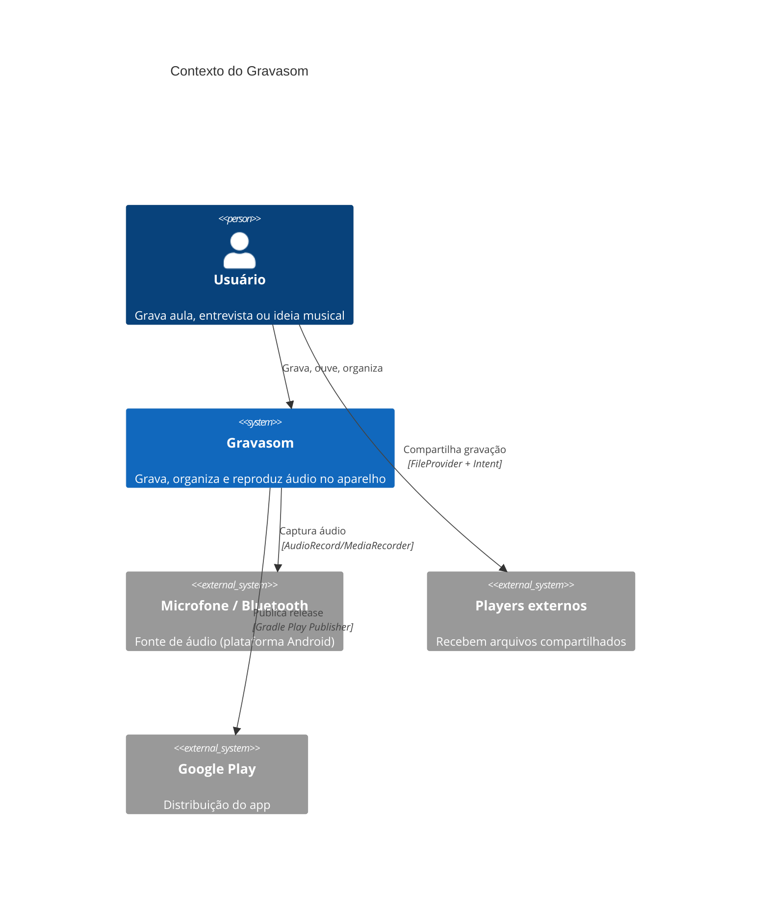

# C4 — Nível 1: Contexto

O Gravasom é um app Android que grava áudio pelo microfone e o mantém no aparelho.
Nada sai sem ação explícita do usuário.

## Fronteiras

- O app não acessa a rede no fluxo principal (disponibilidade 100% offline).
- Telemetria é opt-in e não contém áudio, nome de arquivo nem localização.
